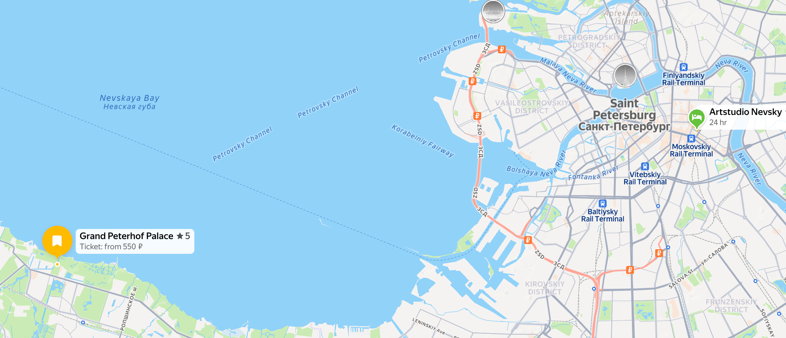
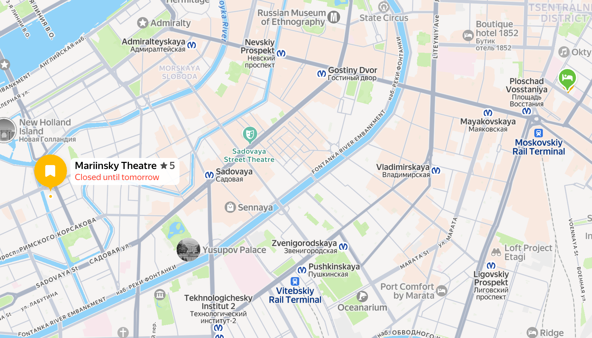
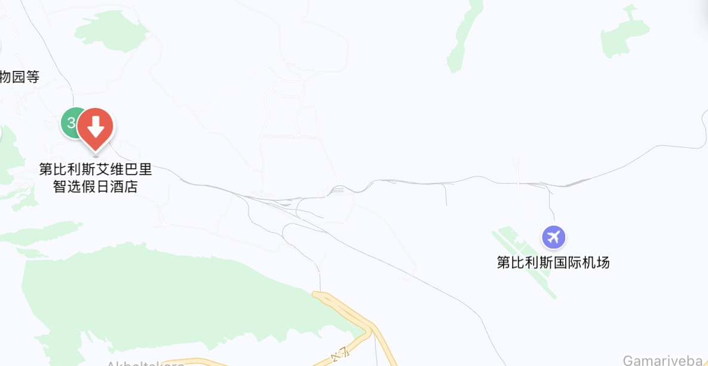
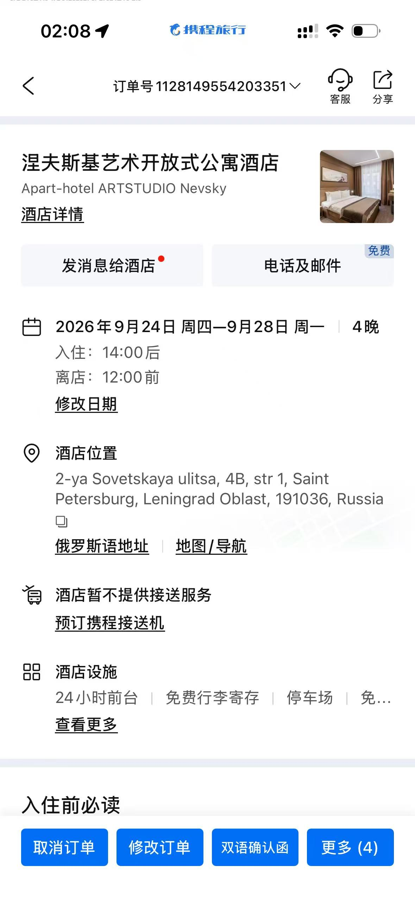
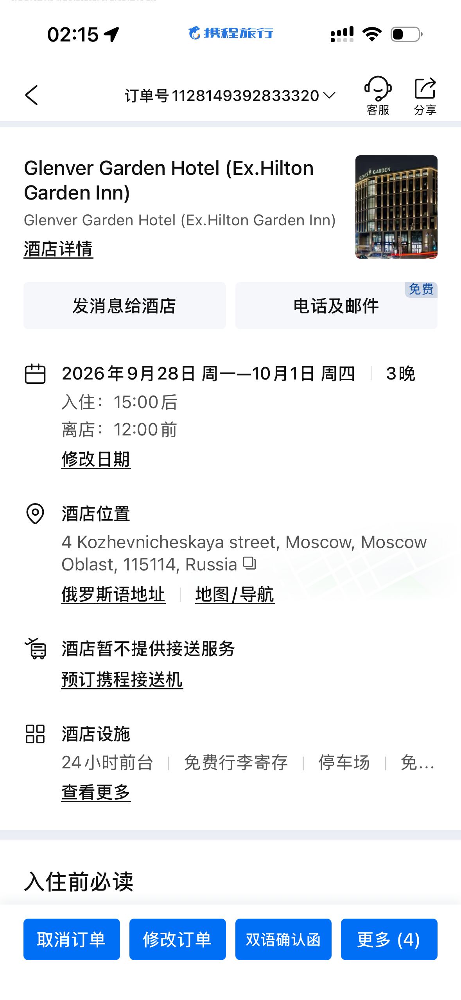
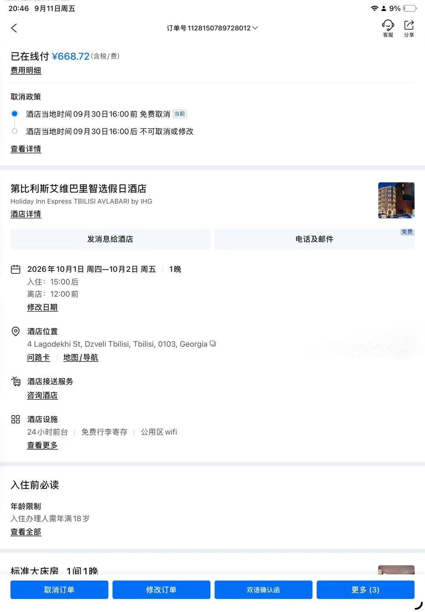

# 🏔️ 俄罗斯+格鲁吉亚 中秋国庆行

> 出行时间：2026.09.24 – 2026.10.07（共14天，10.08到达上海）

---

## ✅ Todo List

### 🚗 交通
- [ ] 圣彼得堡→莫斯科交通方式确定（高铁/飞机）及购票（09.28晚）

### 🏨 住宿
- [ ] 第比利斯10.06晚住宿（梅斯蒂亚返回后，10.07夜机返程）
- [ ] 格鲁吉亚山区民宿（Zhabeshi/Adishi/Iprari/梅斯蒂亚，方案确定后订）

### 🗺️ 行程规划
- [ ] 梅斯蒂亚香草航空小飞机机票确认（闲鱼代订中）
- [ ] 格鲁吉亚段最终方案确定
- [ ] 皇村/夏宫/滴血教堂等门票预订（可选提前官网订）
- [ ] 克里姆林宫门票提前预约

### 🎒 行前准备

#### 🧳 行李方案（24寸行李箱 + 30L双肩包）
- [ ] 24寸行李箱（城市段主力，装衣物+洗漱+杂项）
- [ ] 30L双肩包（徒步包 + 登机随身包，装相机+当天物品）
- [ ] ⚠️ 相机+锂电池必须随身登机，不能托运
- [ ] ⚠️ 梅斯蒂亚小飞机行李限重 **15kg/人（含手提）**，行李箱寄存第比利斯酒店，只带30L包上飞机
- [ ] 徒步3天大件行李寄存梅斯蒂亚民宿（或找当地马帮/吉普车托运到下一站guesthouse）

#### 📄 证件 & 文件
- [ ] 护照（有效期6个月以上，检查！）
- [ ] 打印航班行程单（3段机票）
- [ ] 打印酒店订单（圣彼得堡/莫斯科/第比利斯）
- [ ] 芭蕾电子票 PDF（手机存一份 + 打印一份）
- [ ] 冬宫讲解订单凭证
- [ ] 证件照2张（备用）
- [ ] 护照复印件/拍照存手机（防丢失）

#### 💰 钱 & 卡
- [ ] 卢布现金（国内银行提前预约兑换，俄罗斯主要靠现金）
- [ ] 美元/欧元现金（到格鲁吉亚兑换拉里，汇率更好）
- [ ] 银联卡1张（格鲁吉亚可刷Visa/Master，俄罗斯基本用不了）
- [ ] Visa/Mastercard 信用卡（格鲁吉亚用）

#### 📱 通讯 & APP
- [ ] 俄罗斯电话卡（或开通国际漫游）
- [ ] 格鲁吉亚电话卡（可到当地买，或漫游）
- [ ] 下载 Yandex Maps / Yandex Taxi / Yandex Metro（俄区ID下载）
- [ ] 下载 Bolt（格鲁吉亚打车）
- [ ] 下载 Google Translate + 离线俄语包
- [ ] 下载 Google Maps 离线地图（圣彼得堡/莫斯科/第比利斯）

### 携带物品
#### 🔌 电子设备
- [ ] 平板
- [ ] 手机
- [ ] 欧标插头
- [ ] 充电器
- [ ] 充电宝
- [ ] 耳机
- [ ] 电话卡
- [ ] 手表&手表充电器
- [ ] 充电线 * 2

#### 👔 衣物（俄罗斯9-10月约5-15℃，格鲁吉亚山区更冷）
- [ ] 排骨羽绒服
- [ ] 抓绒衣
- [ ] 冲锋衣
- [ ] 速干衣：薄速干衣 * 3 徒步换洗，短袖速干衣
- [ ] 冲锋裤
- [ ] 速干裤
- [ ] 内裤 ×5
- [ ] 羊毛袜 ×5
- [ ] 雨伞/一次性雨衣
- [ ] 手套（推荐露指摄影手套；徒步塞裤袋/腰封，不用时登山扣挂肩带防丢）
- [ ] 头带

#### 👟 鞋
- [ ] 徒步鞋，时刻穿着
- [ ] 折叠拖鞋

#### 🧴 洗漱用品
- [ ] 牙刷 + 牙膏
- [ ] 洗面奶，小罐
- [ ] 精华水，小罐
- [ ] 面霜，小罐
- [ ] 速干毛巾
- [ ] 剃须刀
- [ ] 指甲刀

#### 🧳 旅行用品
- [ ] U型枕

#### 📷 摄影设备
- [ ] 尼康 ZF + 24-120 镜头
- [ ] 相机包
- [ ] ZF 电池 ×4
- [ ] GR3（小包）+ 电池 ×2

#### 📄 重要文件
- [ ] 护照（有效期6个月以上）
- [ ] 现金：6w卢布，600美元
- [ ] 航班行程单（杭州→圣彼得堡 / 莫斯科→第比利斯 / 第比利斯→上海）
- [ ] 酒店订单（圣彼得堡 / 莫斯科 / 第比利斯）
- [ ] 马林斯基剧院《石花》门票（订单号 5962907，09.27 19:00）
- [ ] 旅游保险单
- [ ] visa卡
- [ ] 以上文件手机/邮箱各存一份电子版

---

## 📋 行程总览

| 日期 | 星期 | 城市/行程 | 住宿 |
|------|------|-----------|------|
| 09.24 | 三 | 杭州→北京→圣彼得堡 | 涅夫斯基艺术开放式公寓酒店 |
| 09.25 | 四 | 圣彼得堡 | 涅夫斯基艺术开放式公寓酒店 |
| 09.26 | 五 | 圣彼得堡 | 涅夫斯基艺术开放式公寓酒店 |
| 09.27 | 六 | 圣彼得堡 | 涅夫斯基艺术开放式公寓酒店 |
| 09.28 | 日 | 圣彼得堡→莫斯科 | Glenver Garden Hotel |
| 09.29 | 一 | 莫斯科 | Glenver Garden Hotel |
| 09.30 | 二 | 莫斯科 | Glenver Garden Hotel |
| 10.01 | 三 | 莫斯科→第比利斯 | 第比利斯艾维巴里智选假日酒店 |
| 10.02 | 四 | 第比利斯 / 梅斯蒂亚（方案待定） | 待订 |
| 10.03 | 五 | 梅斯蒂亚徒步 / 巴统（方案待定） | 待订 |
| 10.04 | 六 | 梅斯蒂亚徒步 / 巴统（方案待定） | 待订 |
| 10.05 | 日 | 梅斯蒂亚徒步 / 巴统（方案待定） | 待订 |
| 10.06 | 一 | 返回第比利斯（方案待定） | 待订 |
| 10.07 | 二 | 第比利斯→上海 | —（夜机） |

> ✈️ 10.07 21:00 起飞，10.08 上午10:00 到达上海浦东

---

## 📅 每日行程

### Day 1 | 09.24 杭州→北京→圣彼得堡
* ✈️ 海南航空 HU7578 杭州→北京
  * 10:30 杭州萧山机场 T3 出发
  * 12:40 北京首都机场 T2 到达
  * 机型：波音737（中），含午餐
* ⏳ 中转北京 2h10m（需重新托运行李）
* ✈️ 海南航空 HU7965 北京→圣彼得堡
  * 14:50 北京首都机场 T2 出发
  * 18:30 圣彼得堡普尔科沃机场 T1 到达
  * 机型：空客330（大），含晚餐
* 🧑‍✈️ 地陪接机（¥300）
* 🏨 入住：涅夫斯基艺术开放式公寓酒店
* 🌙 晚上：抵达后安顿，附近逛逛 / 倒时差

### Day 2 | 09.25 圣彼得堡（地陪市区经典日）
* ⛪ 上午：滴血救世主教堂 + 喀山大教堂
  * 滴血教堂：外部拍照+内部参观
  * 喀山大教堂：免费，宏伟的新古典主义风格
* 🫕 午餐：当地餐厅推荐（红菜汤+俄式饺子）
* 🏛️ 下午：圣以撒大教堂（登顶俯瞰全城）+ 十二月党人广场 + 青铜骑士
* 🚶 傍晚：涅瓦大街漫步，了解交通卡/换钱等实用信息
* 🌙 晚上：涅瓦大街晚餐

### Day 3 | 09.26 圣彼得堡（冬宫日）
* 🏛️ 上午/下午：冬宫博物馆（艾尔米塔什）
  * 中文讲解 + 门票（¥350，已预订）
  * 世界四大博物馆之一，建议预留 4–5 小时
* 🍽️ 午餐：冬宫附近餐厅
* 🌆 傍晚：冬宫广场 + 涅瓦河沿岸散步
* 🌙 晚上：自由安排 / 附近逛逛

### Day 4 | 09.27 圣彼得堡（夏宫+芭蕾日）
* ⛲ 上午：夏宫（彼得霍夫宫）喷泉群
  * 下花园喷泉群最震撼，门票约500₽
  * 从市区坐地铁+公交约1小时，或坐船去更有感觉
* 🍽️ 午餐：夏宫附近餐厅
* 🏙️ 下午：返回市区，回酒店休整
* 🍽️ 晚餐：剧院附近用餐
* 🩰 晚上：马林斯基剧院芭蕾舞《石花》
  * 📍 马林斯基剧院（Mariinsky Theatre）
  * 🕐 09.27 19:00 开演
  * 💺 1层 左侧 9号包厢 1排 13座
  * 💰 票价：9,000₽（约 ¥690）

> 📍 **今日路线参考**：涅夫斯基艺术开放式公寓酒店 → 夏宫（彼得霍夫宫，沿滨海公路约35km）→ 返回市区 → 回酒店休整 → 马林斯基剧院（市区西南，圣以撒大教堂附近）
>
> **酒店→夏宫路线：**
> 
>
> **马林斯基剧院位置：**
> 

### Day 5 | 09.28 圣彼得堡→莫斯科
* 👑 上午：皇村（普希金城）
  * 叶卡捷琳娜宫 + 琥珀屋（必看）
  * 门票约700₽，建议官网提前预约
  * 从市区坐公交/火车约30分钟
* 🧳 中午：返回市区，午餐 + 取行李
* 🚄/✈️ 下午/晚上：圣彼得堡前往莫斯科（交通待购）
* 🏨 入住：Glenver Garden Hotel
* 🌙 晚上：酒店附近散步，适应莫斯科节奏

### Day 6 | 09.29 莫斯科（红场+克里姆林宫日）
* 🏰 上午：克里姆林宫
  * 提前官网预约，军械库 + 钻石馆联票（约1000₽）
  * 建议预留 2–3 小时
* 🍽️ 午餐：红场附近餐厅
* 🎪 下午：红场周边
  * 圣瓦西里大教堂（门票约400₽）
  * 古姆百货 GUM（免费，逛吃+拍照）
  * 列宁墓（免费，需排队）
* 🌙 晚上：特维尔大街漫步 / 莫斯科河夜景

### Day 7 | 09.30 莫斯科（艺术+地铁日）
* ⛪ 上午：武装力量教堂
  * 现代军事主题教堂，建筑震撼，免费参观
  * 距市区较远，建议打车前往
* 🍽️ 午餐：附近餐厅
* 🖼️ 下午：特列季亚科夫画廊
  * 俄罗斯顶级艺术博物馆，建议预留 3–4 小时
  * 门票约500₽，可现场购票
* 🚇 傍晚：莫斯科地铁打卡（顺路）
  * 推荐：基辅站、共青团站、新庄站、革命广场站
  * 单次地铁票约60₽
* 🌙 晚上：阿尔巴特大街漫步 / 晚餐

### Day 8 | 10.01 莫斯科→第比利斯
* ⛪ 上午：基督救世主大教堂
  * 俄罗斯最大东正教教堂，金顶超震撼
  * 免费参观，登顶观景台需购票
* 🏞️ 可选：麻雀山观景台（俯瞰莫斯科全景）
* 🍽️ 午餐：附近餐厅
* 🧳 下午：返回酒店取行李，前往伏努科沃机场
* ✈️ 方位角航空 A47007 莫斯科→第比利斯
  * 17:25 莫斯科伏努科沃机场 A 出发
  * 21:55 第比利斯机场 到达
  * 机型：苏霍伊超100（小），无餐食
* 🏨 入住：第比利斯艾维巴里智选假日酒店（Holiday Inn Express Tbilisi Avlabari）
  * IHG旗下，老城Avlabari区，24小时前台+免费行李寄存
  * 标准大床房，已在线付 ¥668.72

> 📍 **酒店与机场位置参考**（酒店位于老城东北侧 Avlabari 区，距机场约15km）：
> 

### Day 9 | 10.02 — Day 13 | 10.06 格鲁吉亚段

> ⚠️ 格鲁吉亚段行程有三个方案，取决于能否买到梅斯蒂亚小飞机机票，正在闲鱼代订中。

---

#### 🏔️ 方案A（首选）：梅斯蒂亚徒步 + 第比利斯（香草航空小飞机）

| 日期 | 行程 | 住宿 |
|------|------|------|
| 10.02 | 第比利斯飞梅斯蒂亚 → Zhabeshi | Zhabeshi 民宿 |
| 10.03 | Zhabeshi → Adishi（徒步） | Adishi 民宿 |
| 10.04 | Adishi → Iprari（徒步） | Iprari 民宿 |
| 10.05 | Iprari → 乌树故里（Ushguli）→ 返回梅斯蒂亚 | 梅斯蒂亚 |
| 10.06 | 梅斯蒂亚 → 第比利斯（飞机/拼车） | 第比利斯 |
| 10.07 | 第比利斯市区游 → 晚上返程 | — |

**优点**：往返飞梅斯蒂亚节省时间，徒步体验完整，第比利斯有1天游玩
**关键依赖**：能否买到第比利斯↔梅斯蒂亚香草航空小飞机机票

---

#### 🚐 方案B（备选）：梅斯蒂亚徒步 + 第比利斯（拼车往返）

| 日期 | 行程 | 住宿 |
|------|------|------|
| 10.02 | 第比利斯拼车 → 梅斯蒂亚（约8小时）→ Zhabeshi | Zhabeshi 民宿 |
| 10.03 | Zhabeshi → Adishi（徒步） | Adishi 民宿 |
| 10.04 | Adishi → Iprari（徒步） | Iprari 民宿 |
| 10.05 | Iprari → 乌树故里（Ushguli）→ 拼车返回第比利斯 | 夜车 / 第比利斯 |
| 10.06 | 第比利斯市区游 | 第比利斯 |
| 10.07 | 第比利斯市区游 → 晚上返程 | — |

**优点**：不依赖小飞机票，更灵活
**缺点**：拼车单程约8小时，比较辛苦；徒步完直接坐夜车返程很累

---

#### 🏙️ 方案C（保底）：第比利斯 + 巴统 休闲游

| 日期 | 行程 | 住宿 |
|------|------|------|
| 10.02 | 第比利斯市区游（老城、圣三一大教堂、硫磺浴） | 第比利斯 |
| 10.03 | 第比利斯周边（姆茨赫塔古城 + Jvari 修道院） | 第比利斯 |
| 10.04 | 第比利斯 → 巴统（火车/大巴，约5小时） | 巴统 |
| 10.05 | 巴统市区游（黑海、欧洲广场、缆车） | 巴统 |
| 10.06 | 巴统 → 第比利斯 | 第比利斯 |
| 10.07 | 第比利斯市区游 + 采购 → 晚上返程 | — |

**优点**：轻松休闲，不需要徒步体力，不依赖机票
**缺点**：没有梅斯蒂亚徒步的震撼体验

### Day 14 | 10.07 第比利斯→上海
* 🌅 白天：第比利斯活动 / 采购
* ✈️ 东方航空 MU286 第比利斯→上海
  * 21:00 第比利斯机场 出发
  * 次日 10:00 上海浦东机场 T1 到达
  * 机型：空客330（大），有餐食

---

## ✈️ 交通信息

### 航班

#### 杭州→北京→圣彼得堡（09.24）

<table>
<tr>
<th width="70%">航班信息</th>
</tr>
<tr>
<td><strong>第一段：杭州→北京</strong> HU7578 海南航空</td>
</tr>
<tr>
<td>10:30 杭州萧山机场 T3 → 12:40 北京首都机场 T2</td>
</tr>
<tr>
<td>2h10m / 波音737（中）/ 午餐</td>
</tr>
<tr>
<td><strong>第二段：北京→圣彼得堡</strong> HU7965 海南航空</td>
</tr>
<tr>
<td>14:50 北京首都机场 T2 → 18:30 普尔科沃机场 T1</td>
</tr>
<tr>
<td>8h40m / 空客330（大）/ 晚餐</td>
</tr>
<tr>
<td>中转：北京 2h10m，<strong>需重新托运行李</strong></td>
</tr>
<tr>
<td>价格：<strong>¥3,050</strong>（联程）</td>
</tr>
</table>

#### 莫斯科→第比利斯（10.01）

<table>
<tr>
<th width="70%">航班信息</th>
</tr>
<tr>
<td><strong>A47007 方位角航空</strong></td>
</tr>
<tr>
<td>17:25 伏努科沃机场 A → 21:55 第比利斯机场</td>
</tr>
<tr>
<td>3h30m / 苏霍伊超100（小）/ 无餐食</td>
</tr>
<tr>
<td>价格：<strong>¥2,410</strong></td>
</tr>
</table>

#### 第比利斯→上海（10.07 返程）

<table>
<tr>
<th width="70%">航班信息</th>
</tr>
<tr>
<td><strong>MU286 东方航空</strong></td>
</tr>
<tr>
<td>10.07 21:00 第比利斯机场（TBS）→ 10.08 10:00 上海浦东机场 T1（PVG）</td>
</tr>
<tr>
<td>飞行时长：9h0m</td>
</tr>
<tr>
<td>机型：空客330（大）/ 有餐食</td>
</tr>
<tr>
<td>价格：<strong>¥6,806</strong></td>
</tr>
</table>

### 火车/城际交通

#### 圣彼得堡→莫斯科（09.28 晚）
| 项目 | 详情 |
|------|------|
| 方式 | 高铁 / 飞机（待定） |
| 出发时间 | _待补充_ |
| 到达时间 | _待补充_ |
| 班次/航班号 | _待补充_ |
| 预订号 | _待补充_ |

> 📎 票据截图：_待补充_

---

## 🎭 演出门票

### 马林斯基剧院芭蕾舞《石花》（09.27 圣彼得堡）

<table>
<tr>
<th width="70%">门票信息</th>
<th width="30%">📎 电子票</th>
</tr>
<tr>
<td><strong>剧目</strong>：石花（Каменный цветок / The Stone Flower）</td>
<td rowspan="7"></td>
</tr>
<tr>
<td><strong>剧院</strong>：马林斯基剧院（Mariinsky Theatre）</td>
</tr>
<tr>
<td><strong>日期</strong>：09月27日 19:00</td>
</tr>
<tr>
<td><strong>座位</strong>：1层 左侧 9号包厢 1排 13座</td>
</tr>
<tr>
<td><strong>订单号</strong>：5962907</td>
</tr>
<tr>
<td><strong>票价</strong>：9,000₽（约 ¥690）</td>
</tr>
</table>

---

## 🏨 住宿信息

### 圣彼得堡：涅夫斯基艺术开放式公寓酒店（Apart-hotel ARTSTUDIO Nevsky）

<table>
<tr>
<th width="70%">酒店信息</th>
<th width="30%">📎 订单截图</th>
</tr>
<tr>
<td><strong>入住</strong>：09.24 14:00后</td>
<td rowspan="7"></td>
</tr>
<tr>
<td><strong>退房</strong>：09.28 12:00前</td>
</tr>
<tr>
<td><strong>晚数</strong>：4晚</td>
</tr>
<tr>
<td><strong>地址</strong>：2-ya Sovetskaya ulitsa, 4B, str 1, Saint Petersburg, 191036, Russia</td>
</tr>
<tr>
<td><strong>预订号</strong>：1128149554203351</td>
</tr>
<tr>
<td><strong>价格</strong>：¥2,218.46（4晚）</td>
</tr>
<tr>
<td><strong>设施</strong>：24小时前台、免费行李寄存、停车场</td>
</tr>
</table>

### 莫斯科：Glenver Garden Hotel (Ex.Hilton Garden Inn)

<table>
<tr>
<th width="70%">酒店信息</th>
<th width="30%">📎 订单截图</th>
</tr>
<tr>
<td><strong>入住</strong>：09.28 15:00后</td>
<td rowspan="7"></td>
</tr>
<tr>
<td><strong>退房</strong>：10.01 12:00前</td>
</tr>
<tr>
<td><strong>晚数</strong>：3晚</td>
</tr>
<tr>
<td><strong>地址</strong>：4 Kozhevnicheskaya street, Moscow, 115114, Russia</td>
</tr>
<tr>
<td><strong>预订号</strong>：1128149392833320</td>
</tr>
<tr>
<td><strong>价格</strong>：¥2,103.26（3晚）</td>
</tr>
<tr>
<td><strong>设施</strong>：24小时前台、免费行李寄存、停车场</td>
</tr>
</table>

### 第比利斯：第比利斯艾维巴里智选假日酒店（Holiday Inn Express TBILISI AVLABARI by IHG）

<table>
<tr>
<th width="70%">酒店信息</th>
<th width="30%">📎 订单截图</th>
</tr>
<tr>
<td><strong>入住</strong>：10.01 15:00后</td>
<td rowspan="8"></td>
</tr>
<tr>
<td><strong>退房</strong>：10.02 12:00前</td>
</tr>
<tr>
<td><strong>晚数</strong>：1晚</td>
</tr>
<tr>
<td><strong>地址</strong>：4 Lagodekhi St, Dzveli Tbilisi, Tbilisi, 0103, Georgia</td>
</tr>
<tr>
<td><strong>预订号</strong>：1128150789728012</td>
</tr>
<tr>
<td><strong>价格</strong>：¥668.72（1晚，已在线付含税）</td>
</tr>
<tr>
<td><strong>房型</strong>：标准大床房</td>
</tr>
<tr>
<td><strong>设施</strong>：24小时前台、免费行李寄存、公用区WiFi（⚠️ 10.06返程晚住宿另订）</td>
</tr>
</table>

---

## 🌍 旅行信息

### 🛂 入境准备

#### 俄罗斯（免签入境）
- **证件**：护照（有效期需6个月以上）
- **停留期限**：单次最长30天，180天内累计不超过90天
- **入境卡**：飞机上会发，填写后和护照一起保存，出境时收回
- **酒店入住**：入住后酒店会帮你办理「落地签」登记，一般无需自己操心
- **保险**：建议购买覆盖全程的旅游医疗保险

#### 格鲁吉亚（免签入境）
- **证件**：护照（有效期需6个月以上）
- **停留期限**：单次最长30天，180天内累计不超过90天
- **保险**：建议购买覆盖全程的旅游医疗保险

### 📱 必备APP推荐

#### 地图导航
| APP | 适用地区 | 说明 |
|-----|---------|------|
| **Yandex Maps** | 俄罗斯 | ⭐ 首推！本地数据最全，公交/地铁/步行超准，支持英文 |
| **Google Maps** | 通用 | 能用但数据不如Yandex准，搜景点评价方便 |
| **2GIS** | 俄罗斯 | 离线地图强大，有建筑内部平面图 |
| **Yandex Metro** | 俄罗斯 | 专门的地铁APP，线路图清晰，换乘计算准 |

#### 打车
| APP | 适用地区 | 说明 |
|-----|---------|------|
| **Yandex Taxi** | 俄罗斯 | 俄罗斯主流打车软件，价格透明，比路边打安全 |
| **Bolt** | 格鲁吉亚 | 第比利斯用这个，类似当地版滴滴 |

#### 其他实用APP
| APP | 说明 |
|-----|------|
| **Google Translate** | 翻译神器，支持离线俄语/格鲁吉亚语包 |
| **TripAdvisor** | 景点、餐厅评价参考 |

### 💰 货币与支付

#### 俄罗斯（卢布 ₽）
- **现金为王**：Visa / Mastercard 在俄罗斯完全不能用（2022年起停止服务），绝大多数场景靠现金
- **银联卡**：仅极少数大商场、机场店、高端酒店可刷，覆盖率极低，仅作备用
- **支付宝/微信**：基本不能用
- **兑换建议**：国内银行提前兑换卢布现金，或到机场/银行兑换点兑换；避免私下换汇
- **打车支付**：Yandex Taxi 建议用现金支付，下车直接给司机卢布

#### 格鲁吉亚（拉里 ₾）
- **Visa / Mastercard**：正常使用，大部分餐厅、商店、酒店都可刷卡
- **现金**：也建议备一些，小店、市场、打车可能用得上
- **兑换**：第比利斯市区兑换点很多，汇率通常比机场好

### 📞 通讯
_待补充_

### 🔌 电源
_待补充_

### 🛡️ 安全提示
_待补充_

### 🍽️ 餐饮小贴士
_待补充_

### 🇷🇺 常用俄语
_待补充_

---

## 💰 费用预算

### 已确认费用（人均）
| 类别    | 项目             | 金额（¥）          | 备注                    |
| ----- | -------------- | -------------- | --------------------- |
| ✈️ 机票 | 杭州→北京→圣彼得堡     | 3,050          | 海南航空联程（HU7578/HU7965） |
| ✈️ 机票 | 莫斯科→第比利斯       | 2,410          | 方位角航空 A47007          |
| ✈️ 机票 | 第比利斯→上海        | 6,806          | 东方航空 MU286            |
| 🏨 住宿 | 圣彼得堡 4晚        | 2,218.46       | 涅夫斯基艺术开放式公寓酒店         |
| 🏨 住宿 | 莫斯科 3晚         | 2,103.26       | Glenver Garden Hotel  |
| 🏨 住宿 | 第比利斯 1晚（10.01） | 668.72         | Holiday Inn Express Avlabari，已在线付 |
| ✈️ 机票 | 第比利斯↔梅斯蒂亚（代订费） | 646            | 香草航空小飞机，闲鱼代订，出票待确认    |
| 🎫 门票 | 冬宫（含中文讲解）      | 350            | 已预订，含门票+中文讲解          |
| 🎭 演出 | 马林斯基芭蕾舞《石花》    | 690            | 9,000₽，1层左侧9号包厢       |
| 🧑‍✈️ 地陪 | 圣彼得堡接机 + 1天带玩 | 1,050 | 接机¥300 + 当地1天¥750 |
|       | **小计**         | **¥19,992.44** |                       |

### 待确认费用
| 类别 | 项目 | 预估金额 | 备注 |
|------|------|----------|------|
| 🚄 交通 | 圣彼得堡→莫斯科 | 约3,000₽ / 约1,000+ | 高铁或飞机，待定 |
| 🏨 住宿 | 第比利斯10.06晚 + 山区民宿4晚 | _待补充_ | 10.01晚已订Holiday Inn Express |
| 🎫 门票 | 景点门票 | _待补充_ | 冬宫、克里姆林宫等 |
| 🍽️ 餐饮 | 全程餐饮 | _待补充_ | |
| 🚕 交通 | 当地交通（打车/地铁） | _待补充_ | |
| 🛍️ 其他 | 购物、伴手礼 | _待补充_ | |
| 📱 通讯 | 电话卡/漫游 | _待补充_ | |
| 🛡️ 保险 | 旅游保险 | _待补充_ | |
| 🛂 签证 | — | ✅ 免签 | 俄罗斯+格鲁吉亚均免签 |
